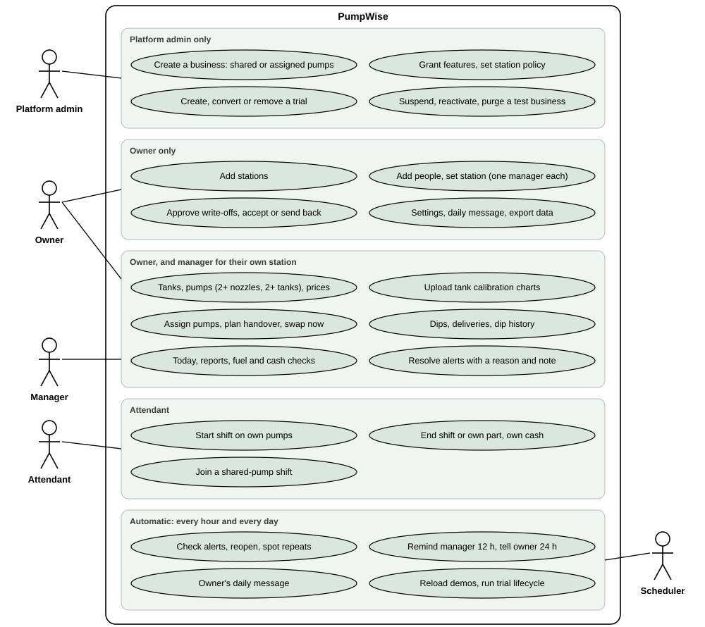
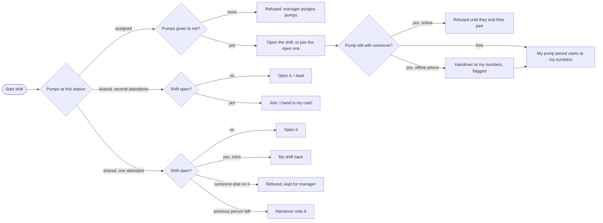
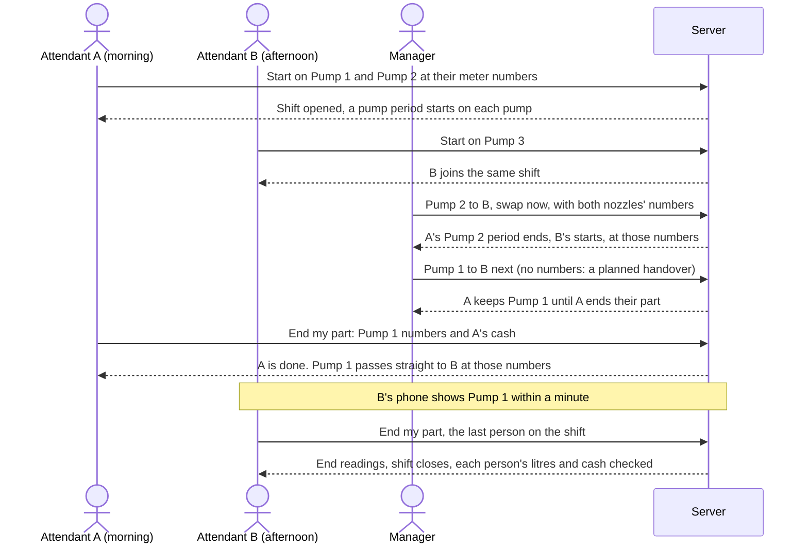
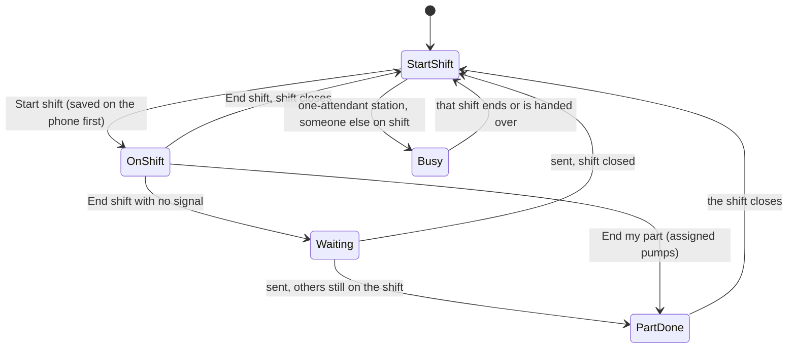
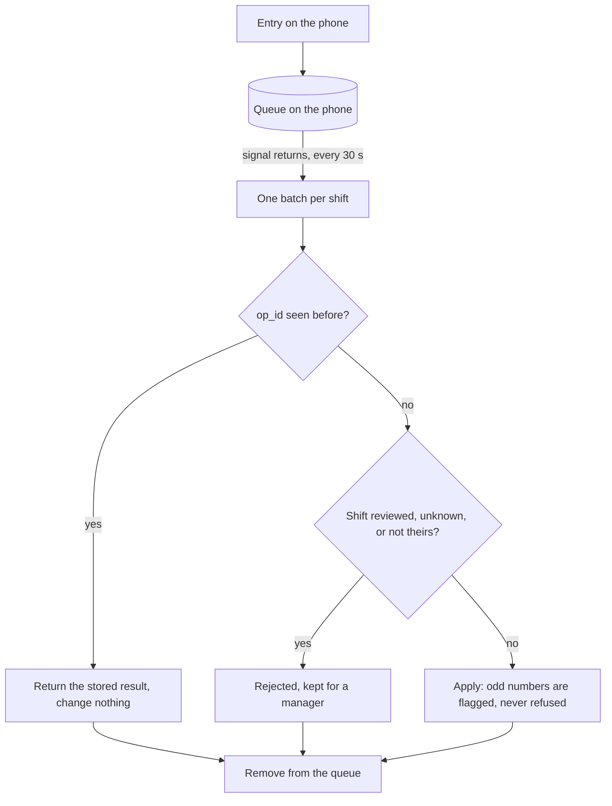
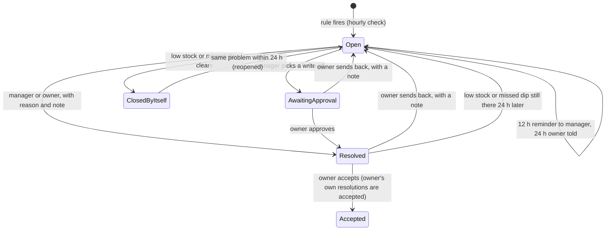

# PumpWise: use cases and flows

How the system behaves, drawn from the code (`backend/apps/operations/services.py`, `apps/insights/alert_actions.py`,
`apps/insights/alerts.py`, `frontend/src/pages/Shift.tsx`, `frontend/src/offline.ts`). Keep these in step with the code.

## 1. Use cases: who does what

Attendants never see tank data (rule 11) and never assign or swap pumps; a manager acts only on their own station.

## 2. Starting a shift

Never two open shifts on the same pumps: their litres would be counted twice.

## 3. Assigned pumps: one shift, many attendants, handovers

Every litre belongs to exactly one person's pump period, so each person's expected cash is their own. If the
incoming attendant is not on the shift yet, they take the pump when they start, at the numbers it was left at.

## 4. What the attendant's phone shows

The server says which stage each person is at (`my_stage` in prefill), so signing out and in, or another phone, lands on the
same screen. Only entries this phone has not sent yet can be newer than what the server knows.

## 5. Offline entries

## 6. Alert lifecycle

A loss or cash difference a person resolved stays resolved: it is still in that day's numbers, so the hourly check
never brings it back. Every step is an `AlertEvent`, shown as "What happened".
